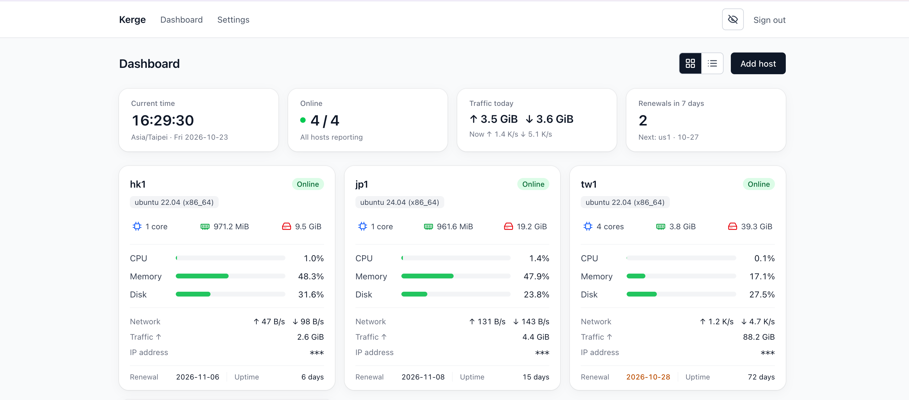
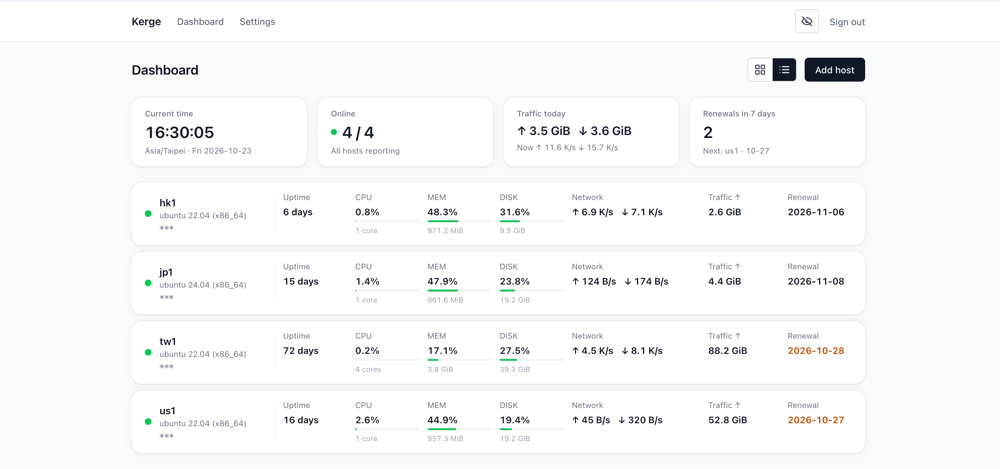

# Kerge panel

A lightweight, self-hosted monitoring panel for your servers. One command
installs the panel, one command adds each host.

- Live and historical CPU, memory, disk and network usage
- Monthly traffic against a limit, and renewal reminders
- Notifications to Telegram, Discord, Slack, Feishu, DingTalk or any webhook
- Read-only by design: the [agent](https://github.com/kergeio/kerge-agent)
  only reports out and never runs commands





## Quick start

You need a Linux server with a domain pointing at it (for example
`panel.example.com`).

**1. Install Docker** (skip if it is already installed):

```
curl -fsSL https://get.docker.com | sudo sh
```

**2. Install the panel:**

```
curl -fsSL https://get.kerge.io | sudo bash
```

The script asks for your domain, gets an HTTPS certificate, and prints the
panel's address and a one-time setup code. Open the address, enter the
code and create your account.

## Install options

### Custom reverse proxy

If nginx, Caddy or another web server already runs on the host, let it
forward to the panel:

```
curl -fsSL https://get.kerge.io | sudo bash -s -- --external-proxy
```

The panel then listens on `127.0.0.1:3000`. Point your web server at it
with WebSocket support; ready-made configs for nginx and Caddy are in
[`deploy/examples/`](deploy/examples/).

### Cloudflare

The installer detects the Cloudflare proxy and configures the panel
automatically. Set the domain's SSL/TLS encryption mode to
**Full (strict)** in Cloudflare.

### All options

Options go after `bash -s --`, for example
`curl -fsSL https://get.kerge.io | sudo bash -s -- --domain panel.example.com`.

| Option | Effect |
|---|---|
| `--domain <name>` | the panel's domain, instead of asking |
| `--version <v>` | install a specific release; default is the latest |
| `--external-proxy` / `--no-external-proxy` | use your own web server / the panel's built-in one |
| `--cloudflare` / `--no-cloudflare` | override Cloudflare detection |
| `--dir <path>` | installation directory; default `/opt/kerge` |

Running the command again keeps your data and the chosen setup. Optional
settings live in `/opt/kerge/.env`; see [`.env.example`](.env.example).

## Development

```
docker compose -f compose.dev.yml up --build
```

Opens the panel on http://localhost:3000 (use Chrome or Firefox). Without
Docker, `make build` builds `bin/panel`. See
[`CONTRIBUTING.md`](CONTRIBUTING.md) and [CHANGELOG.md](CHANGELOG.md).

## License

AGPL-3.0; see `LICENSE` and `NOTICE`. Third-party licenses are in the
image at `/usr/share/doc/kerge-panel/THIRD_PARTY_LICENSES`. The
[protocol](https://github.com/kergeio/kerge-protocol) and the
[agent](https://github.com/kergeio/kerge-agent) are Apache-2.0.
